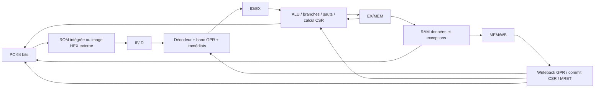

# Architecture réelle du processeur et trajectoire SoC

## État vérifié

Le dépôt contient un cœur RV64 expérimental cinq étages, mono-issue et en ordre.
Le top de simulation courant est `rv64_pipeline`. Il ne s'agit pas encore du
SoC RV64GC quatre cœurs de la spécification cible. Les documents v0.1 restent
des spécifications d'intention/historiques et ne remplacent pas cet inventaire.
Le journal [PROJECT_PROGRESS](../PROJECT_PROGRESS.md) associe travaux et preuves.

## Sous-ensemble ISA présent

| Famille | Implémentation observée | Limites |
|---|---|---|
| Registre-registre | ADD, SUB, SLL, SLT, SLTU, XOR, SRL, SRA, OR, AND | Pas d'extension M, pas de formes W |
| Immédiate | ADDI | Autres opérations immédiates non implémentées |
| Données | LD, SD | 64 bits seulement, alignement naturel, pas de byte/half/word |
| Branches | BEQ, BNE, BLT, BGE, BLTU, BGEU | Résolution EX, pas de prédiction |
| Sauts | JAL, JALR funct3=000 | CF-03 intégré dans main, CI réussie |
| CSR | CSRRW/RS/RC et formes immédiates | Ensemble machine limité, contrôles de conformité incomplets |
| Retour | MRET | Machine-only, pas de changement effectif vers S/U |
| Autres | NOP = ADDI x0,x0,0 | LUI/AUIPC, ECALL, FENCE et reste d'ISA absents |

Cette table n'est pas une déclaration de conformité RV64I. Le compilateur ne
peut pas déduire ce sous-ensemble personnalisé du seul drapeau -march=rv64i.

## État et mémoire

- Reset PC : `0x0000000080000000`, puis pas séquentiel de quatre octets.
- 32 indices GPR ; x0 câblé à zéro, x1–x31 sans remise à zéro générale.
- Instruction fetch : ROM combinatoire choisie par PROGRAM_ID, NOP par défaut.
  CF-04.1/2 ajoutent IMEM_FILE pour une image externe dense de mots 32 bits ;
  contrôles de fichiers et d’adresses en simulation, sans trap de fetch.
  Le paramètre RAW_TEST_PROGRAM conserve la compatibilité des premiers tests.
- Données : 4 096 octets aux adresses basses, little-endian, LD/SD alignés à 8.
  Lecture combinatoire et écriture au front ; INIT_FILE est un paramètre de
  simulation optionnel. Reset empêche l'écriture, sans effacer toute la RAM.
- Pas de cache, TLB, MMU, bus externe, interruptions, DMA ou interface MMIO
  générale dans le top actuel. Chargement HEX d’instructions ajouté localement ; pas de chargement ELF/BIN.

## Contrôle et précision

Les instructions emportent leur PC et leur validité. Les RAW sont résolus par
EX/MEM, MEM/WB ou le bypass WB/ID du banc. Une dépendance immédiate LD→consommateur
insère une bulle. Le stall global et le load-use local ne sont pas synonymes.

Les branches/sauts pris en EX purgent les deux slots plus jeunes. Le lien d'un
saut est le PC de ce saut +4, transporté dans le résultat GPR ordinaire. Les
cibles finales désalignées sont mémorisées en EX/MEM et prises en faute MEM.
Les accès données fautifs distinguent désalignement et dépassement de plage.
Un MRET en WB prime sur les fautes MEM et sur les transferts EX plus jeunes.

CSR implémentés : MSTATUS, MTVEC, MEPC, MCAUSE, MTVAL. MTVEC est direct, aligné
sur quatre ; MEPC conserve un PC aligné. MSCRATCH n'est pas implémenté. Les
adresses inconnues retournent zéro/ignorent l'écriture dans ce modèle partiel.
Les instructions illégales sont neutralisées ; elles ne provoquent pas encore
un trap général. Des flags MIE/MPIE existent, sans contrôleur d'interruptions.

## Frontière matériel / vérification

Le RTL ALU, mux et registres est structuré comme du matériel. La synthèse et
l'inférence des mémoires n'ont pas été validées dans ce livrable. Les programmes
codés dans fetch_path, les interfaces d'observation et les flags Verilator
publics sont des moyens de vérification ; ils ne constituent pas un SoC complet.

Le module `rv64_datapath` est un support pédagogique autonome sans PC/mémoire :
il accepte seulement R-type légaux et ADDI, même si le décodeur partagé connaît
d'autres instructions. Les tops fetch/decode isolés sont eux aussi des niveaux
de test, pas des alternatives architecturalement équivalentes au processeur.

`mem_wb_valid` observe un slot, pas tous les effets architecturaux au commit.
Une future trace de référence devra corréler GPR, CSR, stores en MEM, exceptions
et annulations au lieu d'imprimer chaque instruction qui passe en EX.

## Évolution et portes de validation

1. **CF-03 clos** : main=1df38f7, CI 43008983835 réussie.
2. **CF-04** : backend HEX et tests dirigés validés localement (CF-04.1/2),
   26 suites réussies sous Verilator 5.040.
   Toolchain, conversion ELF et programme assemblé restent à réaliser.
   Voir [contrat et limites](cf04-program-loader.md).
3. **CF-05** : matrice ISA vs code généré, LUI/AUIPC et autres ajouts nécessaires,
   ABI/pile, startup .data/.bss, linker et C sans runtime implicite.
4. **CF-06** : référence configurée pour le sous-ensemble applicable, trace de
   commit correcte, comparaison différentielle puis stimuli aléatoires contraints.
5. **CF-07** : interface mémoire arbitrable et deux cœurs simples, puis
   synchronisation définie et tests inter-cœurs avant trois/quatre cœurs.

Une mémoire partagée sans caches n'a pas besoin de MESI pour être partagée.
Elle exige néanmoins des règles d'ordre/visibilité et des primitives de
synchronisation adaptées. Une extension A ou un périphérique de synchronisation
sera une décision explicite, pas une hypothèse cachée dans les tests.

L'intégration gem5 devra définir les interfaces et le temps simulé. Un échange
fonctionnel C++ n'est pas une co-simulation cycle-précise. StreamPU pourra être
étudié sur hôte, Linux RISC-V ou environnement adapté ; son exécution bare-metal
native n'est pas démontrée. Les accélérateurs commenceront par une IP MMIO
simple et déterministe avant DMA, interruptions et algorithmes plus complexes.

## Liens d'étude

[Architecture CF-03](cf03-jumps.md) · [Implémentation](../implementation/cf03-jumps.md)
· [Vérification](../verification/cf03-jumps.md) · [Cours](../learning/cf03-jumps.md)
· [Décisions](../decisions/cf03-jumps.md).
