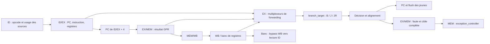

# CF-03 — Architecture des branches, JAL et JALR

Statut : implémentation locale non commitée, revue corrective autorisée.
Le dossier de vérification indique séparément les résultats effectivement
obtenus. Ce document décrit le cœur cinq étages `rv64_pipeline`, pas le module
pédagogique autonome `rv64_datapath`.

## 1. Problème initial et périmètre

CF-01 (`bc4a80b`) reconnaît les six branches conditionnelles. CF-02 (`81eb817`)
les résout en EX avec forwarding et annulation des instructions plus jeunes.
Avant CF-03, le décodeur considère JAL/JALR illégaux, bien que les petits blocs
`branch_target` et `branch_decision` sachent déjà traiter leurs cibles/décisions.
Aucun appel de fonction exécuté par le pipeline ne pouvait donc écrire son lien
et revenir normalement à l'appelant.

CF-03 ajoute les deux sauts, leur lien et les exceptions précises de cible
non alignée. Il ne complète pas RV64I et n'ajoute ni fetch externe, ni MMU,
ni interruptions, ni nouveau CSR.

## 2. Contrat architectural

| Instruction | Dépendances | Cible finale | Résultat GPR |
|---|---|---|---|
| JAL | Aucune | PC + sext(imm_J) | PC + 4 |
| JALR, funct3=000 | rs1 uniquement | (rs1 + sext(imm_I)) & ~1 | PC + 4 |
| Branche conditionnelle prise | rs1, rs2 | PC + sext(imm_B) | Aucun |
| Branche non prise | rs1, rs2 | Séquentielle | Aucun |

Les calculs sont sur 64 bits et rebouclent modulo 2^64. Le déplacement J est
en octets, signé sur 21 bits avec bit bas nul. L'immédiat I est signé sur
12 bits ; il n'est pas décalé. JALR efface le bit 0 **après** l'addition.
Les autres funct3 de JALR restent illégaux. La politique actuelle des
instructions illégales est leur neutralisation, sans trap général cause 2.

Pour `rd=x0`, le saut reste effectif mais aucune écriture ni source de
forwarding de lien n'est autorisée. Pour `rd=rs1`, la cible JALR utilise la
valeur source antérieure à l'écriture du nouveau lien.

## 3. Datapath et chemins de contrôle



Le lien utilise le champ historique `alu_result` des registres de pipeline.
Son nom désigne désormais le résultat GPR non mémoire/non CSR, même quand sa
valeur provient de l'addition PC+4. La cible de saut reste un signal distinct.
Les ports EX/MEM/MEM/WB du résultat et le multiplexeur WB sont réutilisés.
Le sélecteur de forwarding EX/MEM garde sa sélection particulière pour une
ancienne valeur CSR ; un saut utilise le résultat ordinaire, donc le lien.

Le frontend conserve l'instruction complète dans ID/EX. Il identifie le type
de transfert à partir de celle-ci et de valid/illegal, sans ajouter de bits
JAL/JALR à tous les registres de pipeline. Le décodeur est néanmoins l'autorité
pour la légalité et les dépendances ID.

## 4. Séquence cycle par cycle d'un appel

Convention : chaque colonne décrit le cycle avant son front montant final.
Les deux instructions séquentielles derrière le JAL sont du mauvais chemin.

| Cycle | IF | ID | EX | MEM | WB |
|---|---|---|---|---|---|
| 1 | JAL | — | — | — | — |
| 2 | mauvais A | JAL | — | — | — |
| 3 | mauvais B | mauvais A | JAL : cible et lien | — | — |
| 4 | première cible | bulle | bulle | JAL | — |
| 5 | cible suivante | première cible | bulle | — | JAL |
| 6 | … | … | première cible | — | — |

Au front terminant le cycle 3, le PC reçoit la cible et IF/ID, ID/EX sont
vidés. EX/MEM capture le saut : il ne faut pas l'annuler avec ses successeurs.
Au cycle 5, le premier consommateur du lien à la cible peut bénéficier du
bypass WB vers ID du banc de registres. Le fait que le lien emprunte un chemin
forwardable ne signifie pas que chaque appel exerce le bypass EX/MEM.
Il existe deux emplacements jeunes annulés ; aucun CPI moyen n'est revendiqué
sans mesure sur une charge de travail et une convention de comptage.

## 5. Hazards

JAL ne lit aucun registre : les champs qui ressemblent à rs1/rs2 font partie
de son immédiat et ne doivent pas provoquer de load-use. JALR lit rs1 :
- producteur ALU en EX/MEM : bypass direct prioritaire ;
- producteur en MEM/WB : bypass de la donnée WB finale ;
- load immédiatement précédent : arrêt PC/IF-ID et bulle ID/EX pendant le
  cycle nécessaire, puis donnée chargée depuis MEM/WB.

Le `forwarding_unit` ignore rd=x0 et les loads en EX/MEM. Son absence de
qualification uses_rs1/uses_rs2 en EX est acceptable ici : les résultats des
mux inutilisés ne participent pas au calcul d'une instruction sans source.
Les dépendances ID, elles, sont qualifiées précisément.

## 6. Exceptions précises : IALIGN=32

La cible finale d'un transfert **pris** doit avoir ses deux bits bas nuls.
Un JALR vers une somme impaire peut être valide si le seul bit non nul est
le bit 0. Si le bit 1 subsiste, l'exception reste nécessaire. Une branche
non prise ne déclenche pas cette faute.

En EX :
1. Calculer la cible finale et détecter le défaut.
2. Supprimer la redirection normale et l'écriture du lien.
3. Capturer le flag et la cible 64 bits dans EX/MEM.

En MEM :
1. Qualifier le flag par valid, reset, stall et l'annulation externe.
2. Émettre cause=0, EPC=PC du transfert, TVAL=cible finale.
3. Utiliser la redirection de trap existante pour annuler le travail jeune.

La faute n'est pas transportée jusqu'en WB : elle est traitée en MEM et le
registre MEM/WB est purgé. La suppression du lien dans EX/MEM évite aussi
qu'une instruction jeune reçoive un lien fautif par forwarding.

| Événements simultanés | Effet |
|---|---|
| Reset | Remise à l'état initial des registres de contrôle |
| Flush externe | Annulation du travail en pipeline, pas de commit GPR/CSR/store |
| Stall externe | Conservation des registres, aucun événement architectural répété |
| MRET ancien en WB / faute jeune en MEM | MRET gagne, faute jeune supprimée |
| Faute MEM / saut plus jeune en EX | Trap gagne, lien et cible jeunes annulés |
| Écriture MTVEC en WB / faute MEM | L'écriture ancienne termine ; sa valeur détermine la cible de trap |

Le stall diffère d'une annulation : au relâchement, le saut ou le trap en
attente doit se produire une fois. Le bloc PC donne priorité à redirect sur
stall, tandis que le frontend inhibe sa redirection EX lors d'un stall externe.
Cette distinction permet à une redirection légitime de primer sur un hazard
local d'une instruction qui sera annulée.

## 7. Exemple reproductible

À PC=0x80000004, `jal ra,0x80000040` est encodé `0x03c000ef`.
Le lien attendu est 0x80000008. Le programme 36 sauvegarde ce lien en mémoire,
appelle une seconde fonction avec x5, restaure RA, puis exécute RET
(`jalr x0,0(ra)`, `0x00008067`). Son banc exige un retour à l'appelant et vérifie
les deux liens, le cas rd=rs1, une cible impaire et un déplacement négatif.

```bash
VERILATOR=/chemin/vers/verilator-5.040/bin/verilator \
  bash verification/scripts/run_jump_pipeline.sh
```

L'exemple décrit un programme intégré de vérification, pas encore un ELF
chargé dans le CPU. Les résultats réels et leurs limites sont dans
[le dossier de vérification](../verification/cf03-jumps.md).

## 8. Synthèse, modèle et limites

Les additions, mux et registres sont du RTL matériel classique. Aucune
synthèse ni fréquence maximale ni validation FPGA n'est démontrée. La ROM
`case (pc_value)` contient des programmes intégrés ; son paramètre est choisi
à l'élaboration. Le RAM model a une lecture combinatoire et peut être initialisé
par fichier pour la simulation. Son mapping en mémoire FPGA dépend de l'outil.

Le banc de registres x1–x31 et la RAM n'ont pas de remise à zéro générale.
Une valeur nulle initiale de Verilator ne garantit pas la même valeur en
matériel ; les emplacements vérifiés doivent être initialisés explicitement.
Le registre x0, lui, est architecturalement constant.

Fetch externe, instruction-access-fault, instruction-illegal trap général,
conformité CSR complète et instructions RV64I manquantes restent à réaliser.
`mem_wb_valid` n'est pas une trace architecturale complète : les stores ont
leur effet en MEM et certaines instructions neutralisées peuvent rester valid.

## 9. Références et autres documents

- [RISC-V Unprivileged ISA](https://docs.riscv.org/reference/isa/_attachments/riscv-unprivileged.pdf), transferts de contrôle.
- [Implémentation](../implementation/cf03-jumps.md).
- [Vérification et reproductibilité](../verification/cf03-jumps.md).
- [Cours, questions et réponses](../learning/cf03-jumps.md).
- [Journal des décisions](../decisions/cf03-jumps.md).
