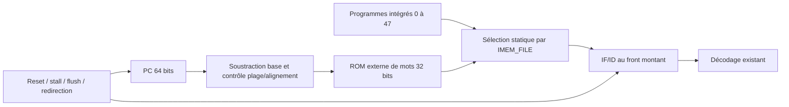

# CF-04.1–CF-04.2 — Contrat de mémoire d'instructions externe

## Périmètre et problème initial

Avant ce jalon, fetch_path contient uniquement des instructions choisies par
PROGRAM_ID. Changer de programme exige de modifier le RTL. CF-04.1/2 ajoutent
une image HEX externe sans modifier le protocole temporel du pipeline.
Le programme externe de vérification est encodé explicitement ; il n'est pas
encore issu d'un assembleur. Installation de toolchain, conversion ELF/BIN et
compilation bare-metal restent les jalons CF-04.3/4.

## Configuration et espace d'adressage

| Paramètre du frontend/top | Défaut | Sens |
|---|---|---|
| IMEM_FILE | chaîne vide | Vide : programmes historiques ; sinon image externe |
| IMEM_WORDS | 1024 | Capacité en mots de 32 bits, soit 4 Kio par défaut |
| IMEM_BASE | 0x80000000 | Adresse du premier mot, alignée sur quatre octets |
| PROGRAM_ID / RAW_TEST_PROGRAM | inchangés | Sélection historique lorsque IMEM_FILE est vide |

La dernière instruction accessible est à base + 4 × (WORDS − 1). La capacité
est strictement positive ; la plage ne doit pas déborder de l'espace 64 bits.
Le PC de reset reste 0x80000000 : changer IMEM_BASE ne change pas le reset.
Un autre placement demande donc un choix explicite du système de démarrage.

Pour une adresse valide, index = (adresse − base) / 4. La soustraction et le
contrôle de plage utilisent 64 bits avant toute conversion d'index : une
adresse haute ne doit pas aliaser la ROM par troncature de ses bits supérieurs.
Tous les mots non fournis par l'image sont initialisés au NOP 00000013.

## Format externe

Image dense : chaque jeton contient exactement huit chiffres hexadécimaux.
Les espaces, retours à la ligne et tabulations séparent les jetons. Un mot
par ligne est la convention recommandée. Pas de @adresse, commentaire, 0x,
underscore, valeur X/Z ou jeton d'un seul octet. Une image vide est rejetée.

Exemple : 00500093 désigne directement ADDI x1,x0,5. Ce mot aurait les octets
93 00 50 00 dans un fichier binaire little-endian. Le HEX de mots ne demande
pas d'inverser son texte. Un futur convertisseur ELF devra reconstruire ces
mots et vérifier placement, trous et limites de sections.

## Chemin de données et timing

La ROM est combinatoire. Au front montant, IF/ID capture le mot correspondant
à l'ancien PC ; le PC peut simultanément avancer. Aucun étage, handshake ou
cycle d'attente n'est ajouté. Le reset invalide IF/ID. Le flush prime sur son
stall. Les priorités PC reset, redirection puis stall restent celles de pc.sv.
Les paramètres sont transmis dans les wrappers fetch/decode/execute/top.

## Erreurs et précision

Le module ROM expose address_fault et retourne un NOP pour une adresse
invalide. En mode externe, fetch_path arrête la simulation au front si :
!reset && !flush && !stall_if_id && address_fault.
C'est un diagnostic de banc, pas une exception ISA : aucun mcause/mepc n'est
créé. Une adresse annulée par redirection avec flush ne doit pas faire échouer
la simulation. Une adresse tenue pendant un stall n'est pas encore acceptée.

MTVEC est remis à 0x80000100 dans csr_file.sv. Cette adresse est dans la
ROM par défaut, mais une petite image peut n’y fournir que le remplissage NOP.
Un futur programme avec traps devra installer un handler ou reconfigurer MTVEC.
Le smoke refuse explicitement tout trap ; il ne valide pas un handler externe.

Les erreurs de fichier sont détectées avant le chargement : fichier absent,
jeton invalide, image vide ou capacité dépassée. Le diagnostic initial est
exclu sous SYNTHESIS ; les opérations de fichiers sont des services de
simulation. Leur prise en charge par un outil FPGA doit être vérifiée.

## Mémoire de données et logiciel

La RAM données reste distincte : 4096 octets aux adresses basses, LD/SD alignés
à huit, little-endian. MEM_INIT_FILE reste indépendant de IMEM_FILE. Le smoke
utilise l'adresse 64 et n'exige aucune donnée initiale : SD précède LD.
Ce mapping Harvard simplifié n'est ni une mémoire unifiée ni un contrat ELF
complet. LUI/AUIPC et plusieurs instructions RV64I restent absentes.

## Alternatives et évolution

| Choix | Avantage | Coût / limite |
|---|---|---|
| ROM combinatoire retenue | Préserve timing et contrôle existants | Inférence BRAM synchrone non assurée |
| ROM synchrone | Adaptée à certaines mémoires FPGA | Gestion de latence et réponses annulées à concevoir |
| Bus requête/réponse | Arbitrage et mémoire partagée futurs | Stall, suivi des transactions et redirections supplémentaires |
| Injection hiérarchique C++ | Peu de RTL initial | Couplage au simulateur et faible portabilité |

Aucune mesure de fréquence, de CPI ou de ressources n'est revendiquée. Ce
jalon n'ajoute pas de cycle mémoire par construction ; cela ne mesure pas le
CPI d'un programme. Le multicœur demandera une interface mémoire explicite.

Voir [implémentation](../implementation/cf04-program-loader.md),
[vérification](../verification/cf04-program-loader.md),
[cours](../learning/cf04-program-loader.md) et
[décisions](../decisions/cf04-program-loader.md).
