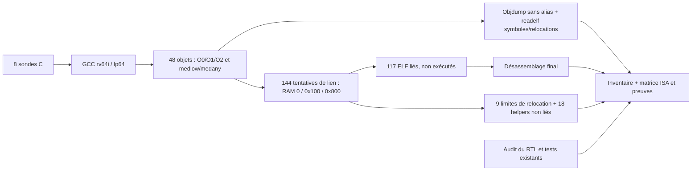

# CF-05.1 — Architecture de l'inspection C et limites du cœur

> Résultats historiques CF-05.1 : 21 formes présentes avant ajout RTL.
> CF-05.2a ajoute LUI/AUIPC ; la matrice dynamique et le garde ELF
> courants comptent 23 formes. Voir [le lot U](cf05-upper-immediates.md).

## Problème initial et périmètre

CF-04 exécute un programme assembleur contrôlé. Cela ne démontre pas que GCC
produit seulement les instructions implémentées. CF-05.1 mesure ce décalage
avant de modifier le RTL. Le cœur reste au même sous-ensemble : 21 formes de
base présentes, sur les 52 formes RV64I classiques inventoriées hors HINTs,
pseudoinstructions, Zicsr/Zifencei et instructions privilégiées.
Aucun programme C de ce corpus n'est exécuté sur le processeur dans ce jalon.

## Chemin d'analyse

Ces nombres sont ceux du corpus figé avec GCC 10.2.0 et Binutils 2.35.1.
Ils ne mesurent ni fréquence dynamique d'instructions, ni CPI, ni conformité.
La régression locale finale passe 28 suites ; aucun programme C n’est exécuté
sur RTL dans ce jalon. Les 28 formes manquantes sont celles observées dans
ce corpus, pas un minimum universel nécessaire à tout programme C.
Les compteurs d'opcodes totalisent des occurrences statiques dans plusieurs
compilations et plusieurs layouts ; ils ne représentent pas un workload réel.

## Configuration expérimentale

ISA demandée : rv64i ; ABI lp64 ; pas de PIC, pas de relaxation demandée,
pas de small-data gp, pas de stack protector ni tables d'unwind. Compilation
freestanding sans builtins. Les liens sont effectués directement par GNU ld,
sans libc ni libgcc. Les fonctions et leurs arguments ne sont pas initialisés
par un startup ; certains points d'entrée ne correspondent pas au reset PC.
Un ELF lié n'est donc pas une image bootable validée.

Les sections code restent à 0x80000000 dans une fenêtre de 4 Kio. La sonde
late_globals place sa fonction à 0x80000f00. Les données sont placées, pour
l'expérience, à 0, 0x100 ou 0x800 dans la RAM basse de 4 Kio. Les sections
rodata/data/bss sont admises par ce linker d'inspection, distinct du linker
CF-04. Aucun de ces nouveaux layouts ne change le RTL ou le mapping matériel.
Le convertisseur normal ELF→HEX conserve son contrat text-only strict.

## Résultats structurants

- Les objets emploient 28 formes absentes du cœur : U-types, immédiats,
  tailles mémoire supplémentaires et les neuf formes W.
- FENCE, ECALL et EBREAK sont absents du RTL mais non rencontrés dans ce corpus.
- Les adresses de fonctions positives à 0x80000000 provoquent des refus
  R_RISCV_HI20 dans function_pointer/medlow : neuf liens refusés.
- Les opérations multiplication/division/reste unsigned produisent des appels
  __muldi3, __udivdi3 et __umoddi3. Dix-huit liens restent refusés parce que
  l'expérience n'ajoute pas libgcc. Cela ne prouve pas que M soit obligatoire.
- Six layouts late_globals/medany montrent un AUIPC dans l'objet et un LUI
  dans l'ELF final (RAM 0 ou 0x100, trois optimisations). Les options no-relax
  ne dispensent donc pas d'inspecter les opcodes réellement liés avec ces outils.

## ABI et mémoire : ce qui reste à définir

Les objets calls/O2 montrent des frames de 32 octets, des sauvegardes de ra,
s0 et s1 par SD, puis restaurations par LD. Ce sont des preuves de génération
logicielle, pas une validation de l'ABI sur notre pipeline. La convention
LP64 à valider utilise a0–a7 pour les arguments, a0/a1 pour les résultats et
une pile alignée sur 16 octets ; le logiciel doit préserver ses callee-saved.

L'architecture Harvard actuelle ne permet pas à LD de lire la ROM code. Un
startup classique copiant .data depuis cette ROM ne peut pas être supposé.
Les alternatives restent : initialisation RAM par le modèle de simulation ;
zone source en RAM préchargée puis copie réelle ; ou accès données à la ROM
avec évolution RTL. La décision devra préciser l'origine des initialiseurs,
la place de rodata/BSS/pile et les limites de mémoire/relocation.

## Évolution proposée, non implémentée

1. U-types et immédiats : réutiliser les opérations ALU existantes ; AUIPC
   utilise le PC de sa propre instruction, LUI une origine zéro, et uses_rs1
   doit exclure leurs champs immédiats pour éviter de faux hazards.
2. Formes W : calcul bas 32 bits et sign-extension avant forwarding/WB ; les
   shifts W utilisent cinq bits et le signe du bit 31, sans dépendre des hauts bits.
3. Largeurs mémoire : transporter taille et extension, adapter alignement,
   bornes, byte enables et forwarding des résultats étendus.
4. Startup et programmes C exécutables, puis comparaison de leurs résultats.

Chaque lot RTL demandera son plan et ses tests avant modification. M, caches,
MMU, OS et trace architecturale CF-06 ne sont pas ajoutés ici.

## Documents associés

[Implémentation](../implementation/cf05-c-toolchain.md),
[vérification](../verification/cf05-c-toolchain.md),
[matrice ISA](../verification/cf05-isa-matrix.md),
[apprentissage](../learning/cf05-c-toolchain.md),
[décisions](../decisions/cf05-c-toolchain.md).

Références d'étude :
[RV64I v2.1](https://docs.riscv.org/reference/isa/v20260120/unpriv/rv64.html),
[options GCC RISC-V](https://gcc.gnu.org/onlinedocs/gcc/RISC-V-Options.html),
[psABI](https://riscv-non-isa.github.io/riscv-elf-psabi-doc/).
Les résultats expérimentaux se rapportent à GCC 10.2.0 et Binutils 2.35.1,
pas à toute option ou extension décrite dans des manuels plus récents.
