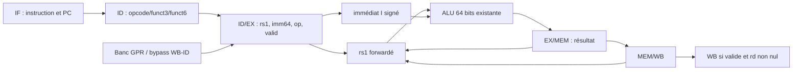

# CF-05.2b — Architecture des opérations immédiates RV64

## Problème et périmètre

L'inventaire GCC a identifié huit opérations OP-IMM absentes après CF-05.2a :
SLTI, SLTIU, XORI, ORI, ANDI, SLLI, SRLI et SRAI. Le décodeur ne reconnaissait
qu'ADDI pour l'opcode 0x13, alors que l'ALU sait déjà comparer, combiner les
bits et décaler des opérandes 64 bits. Sans ce lot, les ELF contenant ces
instructions restent refusés par le filtre et neutralisés dans le pipeline.

Le lot complète OP-IMM RV64I, sans ajouter les formes OP-IMM-32, M ou d'accès
mémoire supplémentaires. La matrice dynamique passe de 23 à 31 formes
présentes sur les 52 de l'inventaire. Cela n'établit pas une conformité RV64I
complète ni l'exécution de programmes C.

## Opérandes et résultats

Toutes ces instructions lisent rs1, portent un rd et n'ont aucune source rs2.
L'immédiat I existant est `sext64(instr[31:20], 12 bits)`. Les opérations
logiques utilisent bien cet immédiat signé étendu sur 64 bits ; un ANDI -1
conserve donc tous les bits de rs1, pas seulement les douze bits bas.

| Instruction | funct3 | Résultat architectural, si rd ≠ x0 |
|---|---|---|
| SLTI | 010 | comparaison signée de rs1 avec l'immédiat étendu, résultat 0 ou 1 |
| SLTIU | 011 | comparaison non signée de rs1 avec ce même immédiat étendu |
| XORI | 100 | rs1 XOR immédiat étendu |
| ORI | 110 | rs1 OR immédiat étendu |
| ANDI | 111 | rs1 AND immédiat étendu |
| SLLI | 001 | rs1 décalé à gauche de shamt[5:0] |
| SRLI | 101 | décalage droit avec remplissage par zéros |
| SRAI | 101 | décalage droit avec réplication du signe de rs1 |

SLTIU n'étend pas son immédiat avec zéro. Pour rs1=0x8000000000000000 et
imm=-2048, le seuil non signé est 0xfffffffffffff800 et le résultat vaut 1.
Une extension zéro donnerait un résultat incorrect.

## Décodage des shifts et encodages réservés

shamt est instr[25:20], donc 0 à 63 en RV64. instr[25] appartient au shamt,
contrairement aux shifts immédiats RV32. La légalité se décide sur six bits :

| Famille | instr[31:26] autorisé | Quantité |
|---|---|---|
| SLLI | 000000 | 64 shamt |
| SRLI | 000000 | 64 shamt |
| SRAI | 010000 | 64 shamt |

Tous les autres préfixes des funct3 001/101 restent illégaux pour le
sous-ensemble RV64I choisi. Ils n'acquièrent aucune sémantique d'une extension
non implémentée. Parmi les 4096 imm12 pour chacun de ces deux funct3, 8000
encodages sont réservés dans ce contrat (4032 à gauche, 3968 à droite).

Le décodeur sélectionne l'opération ALU et active reg_write et alu_src seulement
si l'instruction est légale. uses_rs1=1 et uses_rs2=0 pour les formes légales.
Pour les encodages illégaux, les contrôles et sources restent neutralisés.
L'ALU reçoit l'immédiat I complet mais ses opérations de shift ne consomment
que b[5:0] : le bit de sélection SRAI ne devient pas une quantité de décalage.

## Pipeline et disponibilité

Aucun port ni registre de pipeline n'est ajouté. L'opérande A reste rs1
forwardé, B est l'immédiat ; l'ALU et EX sont inchangés. Le résultat voyage
comme ADDI et devient disponible dans EX/MEM au front suivant son EX.

| Cycle | XORI x22,x0,2 | ANDI x23,x22,3 | Dépendance |
|---|---|---|---|
| n | IF | — | — |
| n+1 | ID | IF | — |
| n+2 | EX | ID | — |
| n+3 | MEM | EX | x22=2 depuis EX/MEM |
| n+4 | WB | MEM | — |
| n+5 | — | WB | x23=2 |

Si une valeur plus ancienne du même rd se trouve dans MEM/WB, EX/MEM gagne.
Une dépendance LD→rs1 impose toujours une bulle. Les bits immédiats ressemblant
au champ rs2 ne doivent jamais créer un stall. Le résultat peut aussi servir
à une branche ou à une adresse/donnée mémoire via les chemins existants.

## Validité, exceptions et frontière du lot

Les règles valid/illegal, x0, flush, reset et stall restent communes. Les
traps mémoire annulent les instructions plus jeunes ; un résultat ancien en
WB reste autorisé au trap d'une instruction plus jeune. MRET retraité conserve
sa priorité sur les instructions plus jeunes. Ces interactions sont testées.

Limitation architecturale préexistante : une instruction illégale est
neutralisée, sans trap général illegal-instruction. Le lot garantit le rejet
et l'absence d'effets des préfixes réservés ; il ne prétend pas implémenter
l'exception RISC-V complète correspondante.

Le datapath pédagogique séparé garde son contrat R/ADDI. Son ancien filtre
sur tout l'opcode OP-IMM aurait élargi ce contrat implicitement ; il exige
désormais funct3=000 pour cette famille. Le pipeline complet accepte les
nouvelles instructions après décodage, conformément au lot.

## Alternatives et compromis

Ajouter des opérations ALU spécifiques aux immédiats dupliquerait des
fonctions déjà présentes et augmenterait les sélections à maintenir. Un
masquage spécifique du shamt dans imm_gen est possible mais inutile : l'ALU
masque déjà à six bits. Le choix garde l'immédiat I commun et le décodage de
légalité au bon endroit. L'ordonnancement ne rajoute pas d'étage ; aucun CPI,
coût en LUT, fréquence ou timing de synthèse n'est mesuré ici.

Le lot ne change ni mémoire Harvard, ni protocole mémoire, ni synchronisation
multicœur. Le mapping et la source des initialiseurs .data restent à décider
avant startup général. Les formes W et tailles de loads/stores restent futures.
