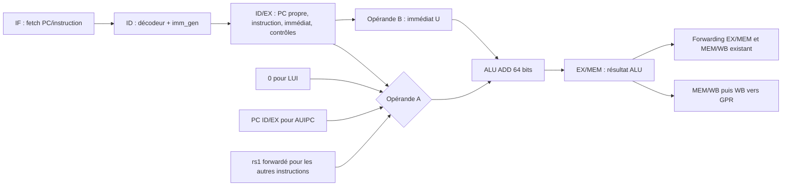

# CF-05.2a — Architecture LUI et AUIPC en RV64

## Problème et périmètre

L'inventaire CF-05.1 a observé LUI/AUIPC dans les objets GCC et les ELF liés,
mais le décodeur les refusait. Les constantes et adresses produites par la
compilation ne pouvaient donc pas être utilisées. Ce lot ajoute ces deux
instructions, sans startup C, nouvelle mémoire ou modification des programmes
intégrés 0 à 47. La matrice vivante passe de 21 à 23 formes RV64I présentes ;
ce n'est pas une déclaration de conformité RV64I complète.

## Sémantique et sources

| Instruction | Encodage | Valeur écrite dans rd si rd ≠ x0 |
|---|---|---|
| LUI | imm20[31:12], rd[11:7], opcode 0x37 | sext64(imm20 << 12, largeur 32) |
| AUIPC | imm20[31:12], rd[11:7], opcode 0x17 | PC de l'instruction + sext64(imm20 << 12, largeur 32), modulo 2^64 |

Tous les bits 31:12 sont de l'immédiat, même ceux correspondant aux champs
rs1/rs2/funct3 d'autres formats. Aucune source registre n'est consommée.
Le bit de signe est instr[31], avant l'addition : AUIPC n'étend pas le signe
d'une somme tronquée à 32 bits. LUI 0x80000 donne ffffffff80000000 ; AUIPC de
même immédiat à 0000000080000004 donne 4. Un résultat d'ALU ne constitue pas
une cible de contrôle : aucune redirection ni exception d'alignement ne doit
être produite par ces instructions seules.

## Chemin matériel

Le PC est capturé avec l'instruction par les registres existants. Employer le
PC de fetch en EX ajouterait le décalage dû aux instructions plus jeunes et
rendrait AUIPC dépendant des stalls/redirections. Aucune extension des ports
ou registres de pipeline n'est nécessaire : ils transportent déjà PC,
instruction et immédiat 64 bits. L'ALU ADD et ses chemins de retour sont réutilisés.

## Contrôle, hazards et exceptions

Le décodeur produit reg_write=1, alu_src=1 et ALU_ADD ; les contrôles mémoire,
CSR et MRET restent à zéro. uses_rs1=uses_rs2=0 empêche un faux load-use stall.
Un multiplexeur de forwarding peut néanmoins réagir aux bits bruts de
l'instruction : l'entrée A spéciale et l'entrée B immédiate doivent ignorer
ces données. forwarded_rs1_out conserve son sens pour branches, JALR et CSR.

Une instruction valide entre dans EX/MEM au front montant, puis MEM/WB au
suivant. Le résultat est disponible en EX/MEM pour un consommateur immédiat,
ou MEM/WB un cycle plus tard. La priorité EX/MEM sur MEM/WB et les exclusions
rd=0 existantes restent applicables. Le banc de registres et WB interdisent
l'écriture architecturale de x0, même si le décodage annonce reg_write.

Les gardes existantes restent responsables des effets architecturaux :
valid/illegal à EX, annulations ID/EX et EX/MEM, qualification WB, priorité
trap mémoire/MRET. Un trap plus ancien annule une U en EX ; un MRET retraité
annule les U plus jeunes en MEM et EX. Un résultat U plus ancien en WB doit
encore être écrit lorsque survient un défaut mémoire plus jeune.

## Cycle par cycle : dépendance immédiate

| Cycle | LUI x5,0x80000 | ADDI x6,x5,1 | Source de x5 |
|---|---|---|---|
| n | IF | — | — |
| n+1 | ID | IF | — |
| n+2 | EX | ID | — |
| n+3 | MEM | EX | EX/MEM : ffffffff80000000 |
| n+4 | WB | MEM | — |
| n+5 | — | WB | x6 = ffffffff80000001 |

Ce tableau illustre le chemin sans stall. Il n'établit pas une mesure de CPI.

## Alternatives et limites

Ajouter une opération ALU dédiée LUI et une autre AUIPC multiplierait les
opérations du package et les points de contrôle ; réutiliser ADD exige
seulement le choix de A. Calculer en ID avancerait le résultat mais ajouterait
un chemin d'addition et des règles de disponibilité différentes. Le choix EX
préserve l'organisation actuelle et la maintenabilité, sans mesure de fréquence
ni de ressources issue d'une synthèse. Rien ici ne fournit des atomiques,
une mémoire cohérente ou un mécanisme de synchronisation multicœur.

Le Harvard existant ne permet toujours pas LD depuis la ROM d'instructions.
Le mapping et l'origine des initialiseurs .data doivent être décidés avant
le startup général ; aucune décision de chargement .data n'est implémentée ici.
